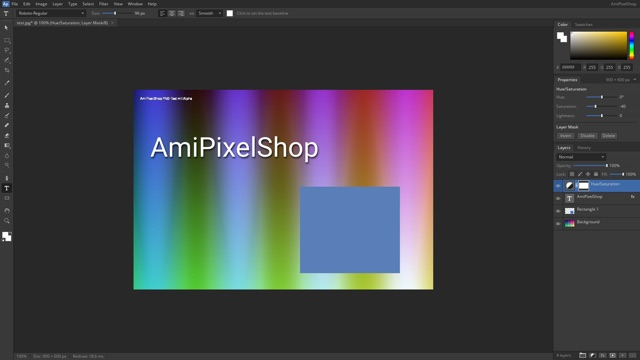

<p align="center">
  
</p>

<h1 align="center">AmiPixelShop</h1>

<p align="center">
  <b>A modern, layer-based image editor for the Amiga.</b><br>
  Native AmigaOS 3.2 &middot; RTG &middot; written in C and 68k assembler<br><br>
  
  
  
  
</p>

---

Everyone is talking about **PhotoCraft**-style image editing - full-featured layer editors are available
on just about every platform today. Now the Amiga gets one too.

AmiPixelShop is **not a port and nothing was reverse-engineered**. It is written from scratch,
natively for the Amiga: plain **C and 68k assembler** - no Rust, no emulation layers, no runtime.
It opens its own RTG screen and draws everything itself, tuned for speed up to 1920&times;1080.

I am a professional art designer, and my goal is to rebuild the tools I use every day as faithfully
as the Amiga allows. Development is done with the help of **Claude** (Anthropic).

> **Early beta - testers wanted!**
> There are certainly still plenty of bugs. Please report anything you find through
> [GitHub Issues](https://github.com/radi7777/AmiPixelShop/issues) - every report helps.

## Features

| | |
|---|---|
| **AI** | Generative Fill with a text prompt, Remove (button or brush), Extend / outpainting, Select Subject, Remove Background - variants and Generate again, via OpenRouter directly from the Amiga (AmiSSL) |
| **Layers** | Up to 64 layers, 25 blend modes, opacity & fill, locks, groups (pass through / isolated), multi-selection, drag &amp; drop |
| **Masks** | Layer and group masks (linked or unlinked), clipping masks |
| **Adjustments** | Levels with histogram, draggable sliders and Auto; Curves with histogram; Brightness/Contrast, Hue/Saturation, Threshold, Posterize, ... |
| **Non-destructive** | Adjustment layers (Levels, Curves, Hue/Saturation, ...), layer styles (Drop Shadow, Outer Glow, Stroke), live Properties panel |
| **Painting** | Brush, Eraser, Clone Stamp, History Brush, Spot Healing, Blur/Sharpen/Smudge, Dodge/Burn, Gradient, Paint Bucket, Shapes |
| **Selections** | Marquee, Lasso, Polygonal Lasso, Quick Selection, Magic Wand, Color Range, Grow, Similar, Feather, Expand/Contract |
| **Type** | TrueType/OpenType text that stays editable - alignment, tracking, leading, anti-aliasing |
| **Paths** | Pen tool with Bezier curves, Paths panel - make selection, fill, stroke; undoable and saved |
| **Transform** | Free Transform, Distort, Perspective, Warp, Crop, Image/Canvas Size, Image Rotation, Trim, Reveal All |
| **Filters** | Liquify, Gaussian, Box & Motion Blur, Unsharp Mask, Sharpen, Median, Add Noise, Emboss, Find Edges, High Pass, Mosaic |
| **Workflow** | Undo/Redo with History panel and History Brush, multiple documents, Auto-Select move tool, customizable toolbar, tooltips, built-in update from GitHub |
| **Amiga colors** | Reduce Colors with live preview: optimized palettes (24 bit, OCS 12 bit, MagicWB, grayscale), 2-256 colors, EHB, HAM6, HAM8, Floyd-Steinberg / Atkinson / ordered dithering; New Document presets for all classic Amiga screen modes |
| **Files** | Native `.aps` (keeps everything), layered `.psd` import, IFF ILBM import and export (EHB, HAM, 24 bit, palette and mode kept), PNG, JPEG, plus all formats your datatypes can read |

## Requirements

- **PiStorm** with Emu68 (JIT-emulated 68040 + FPU) - this is the target platform
- *Maybe:* a real 68060 with FPU and RTG (untested, will be slow at high resolutions)
- **AmigaOS 3.2**
- **RTG** (Picasso96 / P96) with a 24 or 32 bit screen mode, 1024&times;600 up to 1920&times;1080
- 128 MB Fast RAM or more
- *For the AI features:* Roadshow, AmiSSL v5 and an OpenRouter API key

**Tested on:** Amiga 500 + PiStorm (Raspberry Pi 3A+, Emu68), AmigaOS 3.2.3, P96.

Classic 68000-68030 machines and AGA/ECS screens are **not** supported.

## Getting started

1. Download the latest archive from [Releases](https://github.com/radi7777/AmiPixelShop/releases) (also on Aminet).
2. Unpack it, e.g. to `Work:`, and start `AmiPixelShop`.
3. Choose a screen mode on the first start.

**Read the HTML Guide for instructions:** [`docs/Guide.html`](docs/Guide.html) - it is included in the archive
and works in IBrowse, AWeb and Voyager.

## Building from source

Cross-compiled on macOS/Linux with [bebbo's amiga-gcc](https://github.com/bebbo/amiga-gcc) and vasm:

```sh
make            # produces build/AmiPixelShop
```

Notes: compile with `-m68040 -m68881` and link with `-mcpu=68020 -m68881` (see `Makefile`) -
otherwise the math library goes through the Amiga math libraries and clobbers the FPU registers.

## Reporting bugs

Please open an [issue](https://github.com/radi7777/AmiPixelShop/issues) and include:

- what you did and what happened
- your setup: PiStorm model, Emu68 version, AmigaOS version, screen mode, RAM
- a screenshot or the image, if possible

## License

AmiPixelShop is released under the [MIT License](LICENSE).

Third-party code: [stb](https://github.com/nothings/stb) (stb_image, stb_image_write, stb_truetype -
Public Domain / MIT) and [zlib](https://zlib.net) (zlib License). Interface font: Open Sans (Apache License 2.0).

AmiPixelShop is an independent project and is not affiliated with any other software or vendor.
All trademarks belong to their respective owners.
